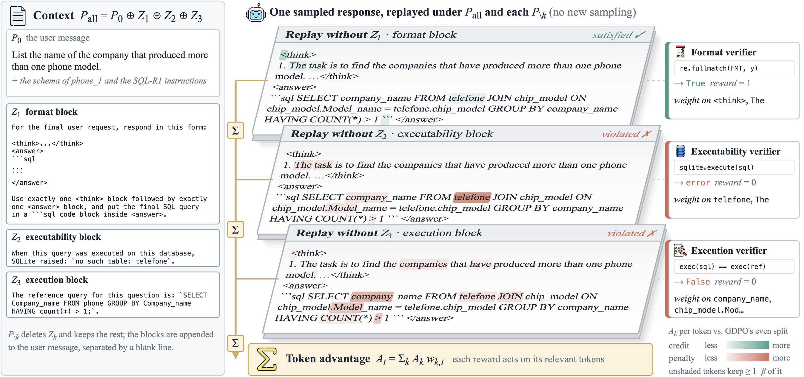
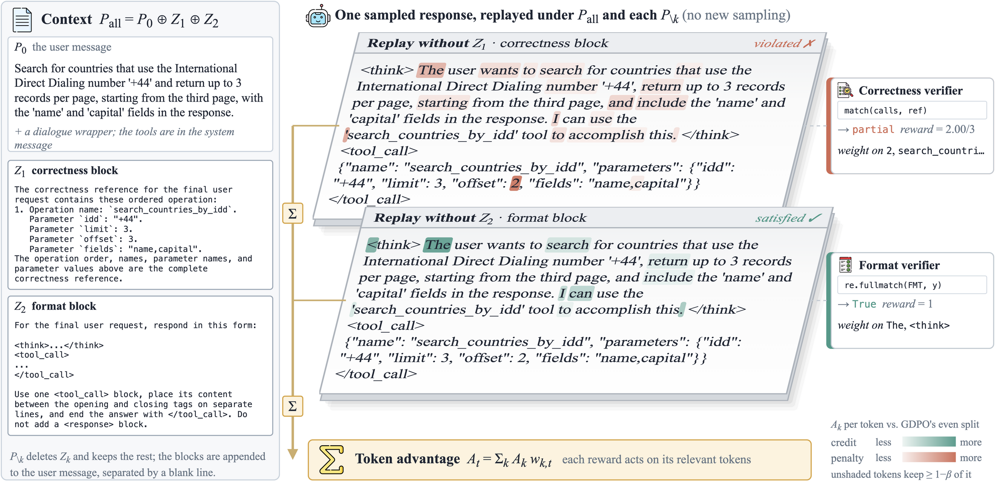
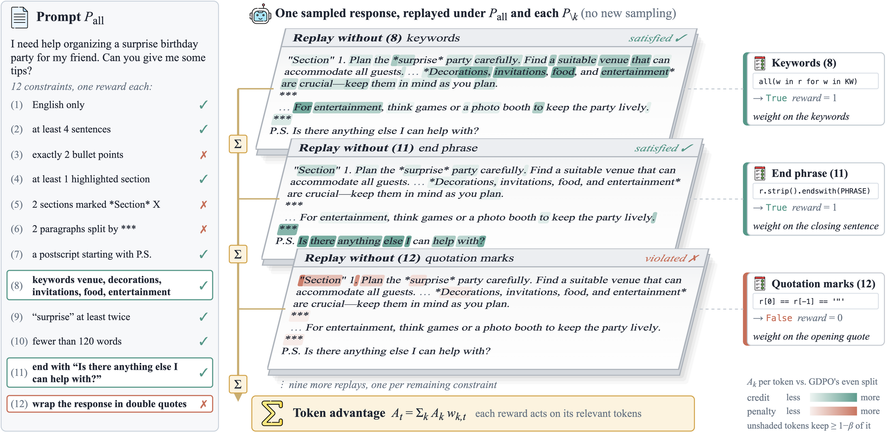

# Replay viewer

Before training MRTPO on a new task, you can check where each reward's weight would land. This tool replays responses
with the base model, exactly as MRTPO's replay does during training, and draws one row per reward with every response
token shaded by its Jensen–Shannon distance.

For one prompt and one response, and for every reward k:

1. **P_all** is the prompt P_0 with every non-empty verifier block appended to the end of the user message, each after
   a blank line, in the order the rewards are listed. The system message is unchanged.
2. **P_minus_k** is the same prompt without block k. For a reward whose information the prompt already shows (one
   constraint of an instruction), you give P_minus_k directly: the prompt with that constraint left out.
3. The same response token ids are appended to both prompts (prompt ids + response ids; the response is never
   re-tokenized), and the model scores both sequences in one forward pass each.
4. At every response position, the full-vocabulary Jensen–Shannon divergence between the two next-token distributions
   is computed in fp32 (`mrtpo/js.py`), and q = sqrt(JS / ln 2).
5. The token weights are w = (1 − β) + β · q / mean(q), with β = 0.5 (`mrtpo/advantage.py`, after the warm-up). They
   have mean 1 over the response.

A reward whose block is empty for a response (the executable block of a query that ran) is not replayed and keeps
uniform weights, as in training.

## Examples from the paper

The three figures of the paper, each one training response replayed once per reward. Every token is shaded by that
reward's weight: green where a satisfied reward's credit concentrates, red where a violated reward's penalty does.

**Text-to-SQL.** The response reads table `telefone`, which does not exist; the reference uses `phone`. The penalties of
the executability and execution rewards fall mainly on `telefone` and the selected columns, and the format credit on
the tags.



**Tool calling.** The response sets `offset` to 2; the reference has 3.



**Instruction following.** A response to a prompt with 12 constraints; three of the replays are shown.



## Installation

The `mrtpo` environment of [`verl_mrtpo/environments`](../verl_mrtpo/environments) has everything (PyTorch 2.6.0,
transformers 4.53.2); outside it, PyTorch and transformers are enough, and the tool imports `mrtpo` from
[`../verl_mrtpo`](../verl_mrtpo). `--png` also needs `pip install matplotlib`.

```bash
python -m pytest -q replay_viz/tests    # CPU checks; the end-to-end test uses a tiny random Qwen2 model
```

## Input

One JSON file per prompt:

```json
{
  "name": "Text-to-SQL: Spider train, department_management",
  "messages": [{"role": "user", "content": "Task Overview: ..."}],
  "rewards": [
    {"name": "format", "block": "For the final user request, respond in this form: ..."},
    {"name": "executable", "block": "When this query was executed on this database, SQLite raised: `no such column: head_age`."},
    {"name": "correct", "block": "The reference query for this question is: `SELECT count(*) FROM head WHERE age  >  56`."}
  ],
  "responses": [
    "<think>\nCount the heads older than 56.\n</think>\n<answer>\n```sql\nSELECT count(*) FROM head WHERE head_age > 56\n```\n</answer>",
    {"text": "<think>\n...SELECT count(*) FROM head WHERE age > 56 ...", "blocks": {"executable": ""}}
  ]
}
```

- `messages`: the rollout prompt P_0 as chat messages; the model's chat template renders it.
- `rewards`: in block order. Each reward has a `name` and either `block` (text added in the replay; empty means not
  replayed) or `minus_prompt` (P_minus_k: the text of the last user message, or a full list of messages).
- `responses`: response texts. A response may be an object with `blocks` that replace the given blocks for that
  response, for blocks that depend on the response, such as the SQLite error. A given text is tokenized once and ends
  with the tokenizer's end-of-turn token, as a sampled response does. With `--sample N` the tool samples N responses
  under P_0 instead (repetition penalty 1.0) and keeps their exact token ids; the blocks are then the given
  ones.

The three examples in [`examples/`](./examples) are built with the release's own block builders, so their contexts
are the ones training uses:

| file | prompt | rewards |
|---|---|---|
| `text_to_sql.json` | Spider train question 0 (`department_management`) with its SQL-R1 prompt and schema | format, executable, correct ([`mrtpo/sql/constructions.py`](../verl_mrtpo/mrtpo/sql/constructions.py), [`mrtpo/reward/sql_reward.py`](../verl_mrtpo/mrtpo/reward/sql_reward.py)) |
| `tool_calling.json` | ToolRL `rlla_4k` training row 3220 (`generate_quiz`) | correctness, format ([`rlla_replay.py`](../tool_calling/vendor/verl/verl/utils/rlla_replay.py)); the correctness block shows the schema-typed reference |
| `instruction_following.json` | the six-constraint prompt of the [instruction-following README](../instruction_following/README.md) in HIR's bullet layout | one per constraint, each with its leave-one-out prompt ([`mrtpo/hir.py`](../verl_mrtpo/mrtpo/hir.py)) |

## Usage

Run from the repository root. Each command writes `<out>/<example>.html` and `<out>/<example>.json`.

```bash
python replay_viz/replay.py --model Qwen/Qwen2.5-Coder-7B-Instruct --input replay_viz/examples/text_to_sql.json \
  --out viz --temperature 1.1
python replay_viz/replay.py --model Qwen/Qwen2.5-1.5B-Instruct --input replay_viz/examples/tool_calling.json --out viz
python replay_viz/replay.py --model Qwen/Qwen2.5-7B-Instruct --input replay_viz/examples/instruction_following.json --out viz
```

To replay the model's own responses, add `--sample 4` and the setting's sampling settings, for example
`--sample 4 --top-p 0.99 --top-k 100 --max-new-tokens 4096` for instruction following.

| option | default | meaning |
|---|---|---|
| `--model` | – | Hugging Face model id or local path |
| `--input`, `--out` | – | example JSON, output directory |
| `--sample N` | 0 | sample N responses under P_0 instead of using the given ones |
| `--beta` | 0.5 | β of the weights |
| `--temperature` | 1.0 | sampling temperature; the replay divides the logits by it, as training does (text-to-SQL trains at 1.1) |
| `--top-p`, `--top-k`, `--max-new-tokens`, `--seed` | 1.0, 0 (off), 1024, 0 | sampling |
| `--device` | auto | `cuda`, `mps` or `cpu` |
| `--dtype` | bfloat16 | model weights; the JS is always computed in fp32 |
| `--png` | off | also write `<out>/<example>_response<i>.png` |

The JSON holds, for each response, the token ids, the decoded tokens, the rendered P_all and, for each reward, its
block, the rendered P_minus_k, and per token `js`, `q` and `w`.

## Reading the page

The page shows the rendered P_0, and for each response the rendered P_all and one row per reward. A row's header gives
the reward's mean and largest q; its block and P_minus_k are under the header. A token's shade is its q, on one scale
for the whole page, from white (0) to full colour (the largest q on the page); hover a token for q, w and JS. Dark
tokens are the positions whose next-token distribution depends most on the reward's information, and they receive
the largest share of that reward's advantage.

The weights do not always land where one expects. Often a large share falls on the reasoning or thinking part of the
response rather than on the final answer, as in on-policy self-distillation: the information changes how the model
reasons on the way to the answer, not only the answer tokens. One response can mislead, so look at several sampled
responses before deciding how to write a block.
